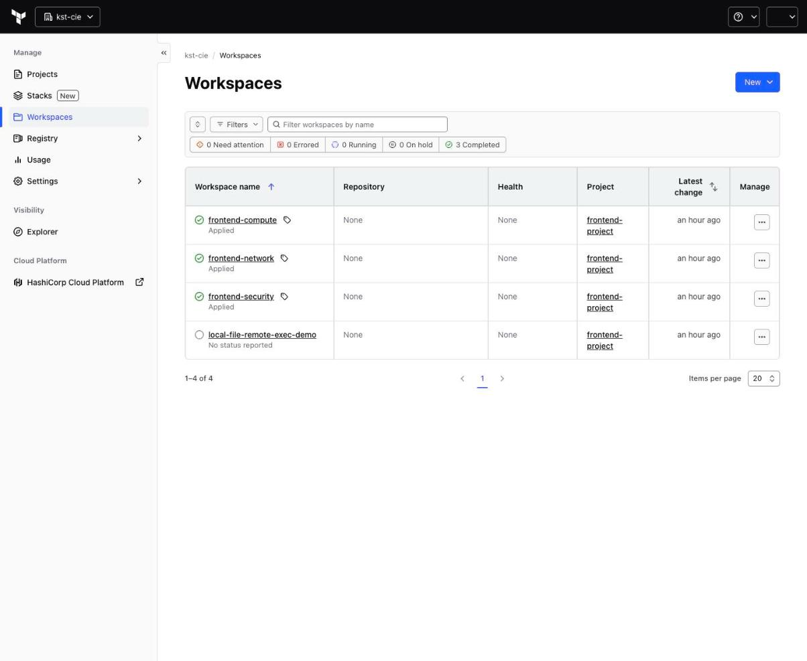
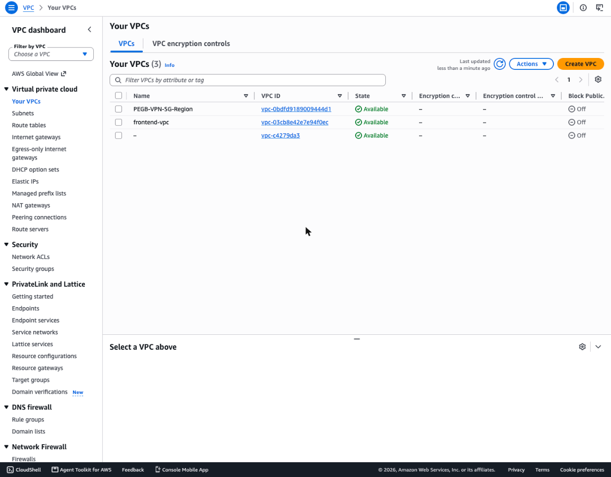
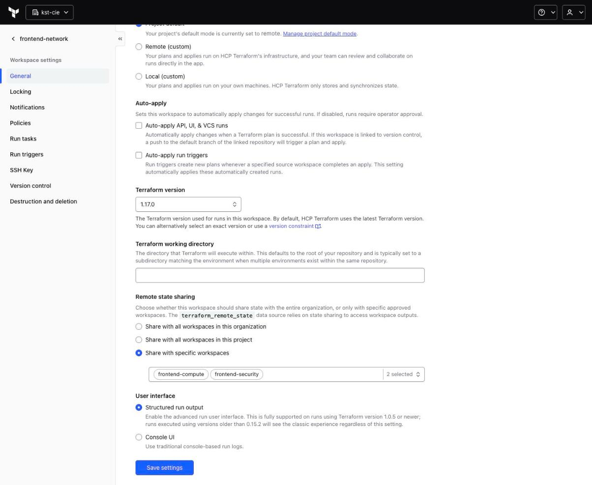
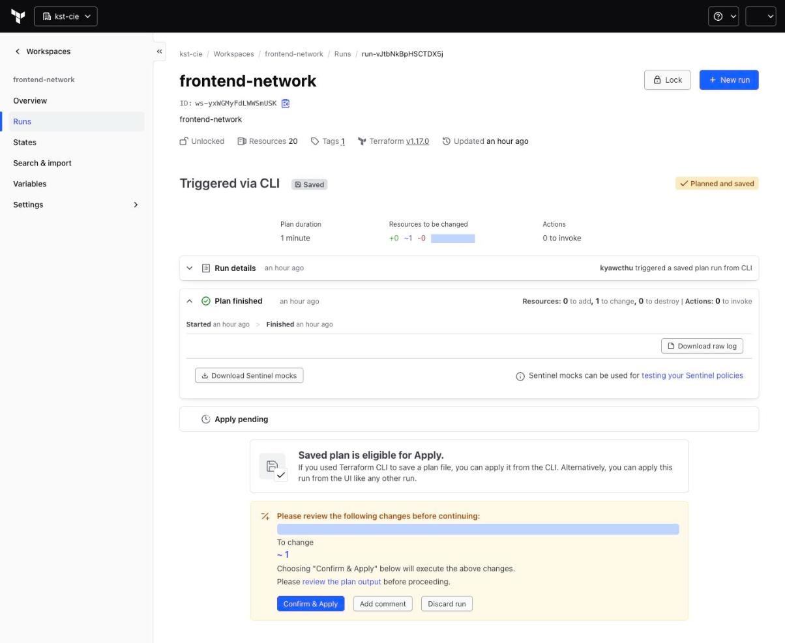

# Lesson 01: Moving the frontend stack to a new HCP Terraform organization

> **Branch:** `01-hcp-migration-troubleshooting` (builds on `main`)
> **Drawing:** Excalidraw → Gitops → *tf-cloud 01 - HCP migration troubleshooting*
> **Tested:** 2026-10-23, HCP org `kst-cie`, AWS account `1733xxxx6280`, region `ap-southeast-1`

`main` is the lecture code as handed out. It points at the `HelloCloud_learning` organization, which uses `*-ws` workspace names and expects a backend stack to peer with. This lesson moves the **frontend stack only** into a new organization (`kst-cie`) and fixes every error we hit on the way, in the order we hit them.

| # | Symptom | Root cause | Fix |
|---|---|---|---|
| 1 | `Unsupported Terraform Core version` | Local CLI 1.13.3, code needs `>= 1.16` | Install 1.17.0 |
| 2 | `Failed to read organization "emrys"` | `cloud {}` block pointed at the wrong org | `organization = "kst-cie"`, workspace names without `-ws` |
| 3 | `unauthorized` reading the org | Expired/revoked HCP token in `~/.terraform.d/credentials.tfrc.json` | `terraform login` |
| 4 | Plan fails reading `HelloCloud_learning` | `terraform_remote_state` still pointed at the old org | Fix `data.tf` in security + compute |
| 5 | Same error, from `frontend-network` | VPC peering reads `backend-network`, which doesn't exist in `kst-cie` | Frontend-only: peering disabled |
| 6 | `VpcLimitExceeded` | 5 VPCs already in the region (AWS default quota) | Deleted 3 unused VPCs + 1 idle NAT gateway |
| 7 | "Wrong account?" red herring | Assumed HCP used a different AWS account | Proved `frontend-vpc` lands in the same account |
| 8 | `Value for undeclared variable AWS_DEFAULT_REGION` | Set as a *Terraform* variable, not an *env* variable | Change category to Environment |
| 9 | (would be) `forbidden` reading remote state | HCP blocks state reads between workspaces by default | Remote state sharing per workspace |
| 10 | `1 to change` on every network plan | Route uses `gateway_id` for a NAT gateway | Documented (fix: `nat_gateway_id`) |
| 11 | `2 to destroy, 2 to add` on every compute plan | `null_resource` triggers on `timestamp()` | Documented (intentional redeploy) |
| 12 | Junk + a secret near the repo | Terraform zip/LICENSE left in repo, API token in `.mcp.json` | `.gitignore` + cleanup |
| 13 | Backend folders | Not used in `kst-cie` | Removed on this branch |

---

## 1. Terraform version too old

**Symptom**
```
$ terraform init
Initializing HCP Terraform...
Error: Unsupported Terraform Core version
  on versions.tf line 2, in terraform:
   2:   required_version = ">= 1.16"
This configuration does not support Terraform version 1.13.3.
```

**Cause:** `required_version` is checked by your **local** CLI before it even talks to HCP.

**Fix:** download the binary for your platform (`terraform_1.17.0_darwin_arm64.zip`), unzip it and replace the old one:
```bash
unzip terraform_1.17.0_darwin_arm64.zip
mv terraform /usr/local/bin/terraform
terraform version        # Terraform v1.17.0 on darwin_arm64
```
Don't leave the zip, the binary or `LICENSE.txt` inside the repo (see #12).

**Also check:** every HCP workspace has its own Terraform version (**Settings → General → Terraform version**). Ours are `1.17.0`, as the remote state sharing screenshot in #9 shows.

---

## 2. Wrong organization / workspace names

**Symptom**
```
Error: Failed to read organization "emrys" at host app.terraform.io
  on versions.tf line 13, in terraform:
  13:     organization = "emrys"
```

**Cause:** the `cloud {}` block must match the org and workspace names exactly. `main` uses `HelloCloud_learning` and `frontend-*-ws`, but the new org is `kst-cie` with workspaces named `frontend-network`, `frontend-security` and `frontend-compute`.



**Fix:** in all three `frontend-*/versions.tf`:
```hcl
cloud {
  organization = "kst-cie"
  workspaces {
    name = "frontend-network"   # frontend-security / frontend-compute
  }
}
```

---

## 3. `unauthorized`: expired HCP token

**Symptom** (after fixing #2)
```
Error: Failed to read organization "kst-cie" at host app.terraform.io
Encountered an unexpected error while reading the organization settings: unauthorized
```

**Diagnosis:** the token saved in `~/.terraform.d/credentials.tfrc.json` was rejected for *every* API call, including `GET /api/v2/account/details`. So this was not a permissions problem on `kst-cie`; the token itself was dead.

**Fix:**
```bash
terraform login     # opens the browser, create a user token, paste it back
```

---

## 4. Remote state still pointing at the old organization

**Symptom:** `init` works, but `plan` fails inside the run:
```
Error: Failed to read organization "HelloCloud_learning" at host app.terraform.io
  with data.terraform_remote_state.backend_network,
  on data.tf line 2 ...
organization "HelloCloud_learning" at host app.terraform.io not found.
```

**Cause:** `cloud {}` (#2) decides where *this* workspace's state lives. Each `terraform_remote_state` block has its **own** org/workspace config, which also needs updating.

**Fix:** `frontend-security/data.tf` and `frontend-compute/data.tf`:
```hcl
config = {
  organization = "kst-cie"
  workspaces = {
    name = "frontend-network"     # and "frontend-security" in compute
  }
}
```

---

## 5. VPC peering with a backend that doesn't exist

**Cause:** `frontend-network/peering.tf` peers with `backend-network` and reads its VPC ID and route tables from remote state. There is no backend in `kst-cie`.

**Decision:** deploy the frontend on its own. `frontend-network/peering.tf` and `frontend-network/data.tf` are fully commented out, with a note at the top. To bring the backend back, restore `backend-*` from `main`, point it at `kst-cie`, apply `backend-network` first, then uncomment both files.

---

## 6. `VpcLimitExceeded`

**Symptom** (first real apply of `frontend-network`)
```
aws_eip.frontend_natgw_eip: Creation complete after 2s
aws_vpc.frontend_vpc: Creating...
Error: creating EC2 VPC: ... api error VpcLimitExceeded: The maximum number of VPCs has been reached.
```

**Diagnosis:** the region already had 5 VPCs, which is the default quota. For each one we checked what was inside it (network interfaces, instances, NAT gateways, VPN/TGW attachments, peering, subnets):

| VPC | Contents | Action |
|---|---|---|
| `PEGB-VPN-SG-Region` | pfSense instance, Directory Service, WorkSpaces | **kept** |
| default VPC | empty | **kept** (default) |
| unnamed `172.16.0.0/16` | nothing | deleted |
| `hc-eks-vault-boundary-vpc` | 6 subnets, nothing running | deleted |
| `kst-devops-aws-singapore-vpc` | 3 subnets + an **idle NAT gateway** (~$30–35/month) | deleted |

Delete order matters, because a VPC can't be deleted while anything is still in it:
1. NAT gateway, then wait for `nat-gateway-deleted`
2. detach and delete the internet gateways
3. subnets
4. non-main route tables
5. security groups: revoke their rules first, since they referenced each other
6. the VPC itself

**Result:** 3 VPCs left, and `frontend-vpc` was created on the next apply.



> Alternative if nothing can be deleted: request a higher **VPCs per Region** quota in Service Quotas, or deploy to another region.

---

## 7. Red herring: "HCP is using a different AWS account"

The failed apply in #6 had created an Elastic IP (`eipalloc-0abf48fd…`), and that ID was **not found** in the account we were cleaning up. That suggested the HCP credentials pointed at another account, in which case deleting VPCs here would have been pointless.

**What actually happened:** after the cleanup, `frontend-vpc` (`vpc-03cb8e42e7e94f0ec`) appeared in the **same** account. The EIP had simply been cleaned up along with the failed run.

**Lesson:** before you delete anything to unblock HCP, confirm which account the workspace credentials belong to. The quickest way is to create something small and look for it, or add `data "aws_caller_identity" "current" {}` with an output.

---

## 8. `AWS_DEFAULT_REGION` warning

**Symptom**
```
Warning: Value for undeclared variable
The root module does not declare a variable named "AWS_DEFAULT_REGION" but a value
was found in file ".../terraform.tfvars".
```

**Cause:** in the variable set, `AWS_DEFAULT_REGION` had category **Terraform variable**. HCP writes those into `terraform.tfvars`, but the AWS provider reads `AWS_*` from the **environment**.

**Fix:** set the category to **Environment variable**, as `AWS_ACCESS_KEY_ID` and `AWS_SECRET_ACCESS_KEY` already were (secret key marked *sensitive*). Our variable set `AWS_ACCESS_ID` is scoped to the project `frontend-project`, so every frontend workspace inherits it.

---

## 9. Remote state sharing

HCP Terraform does not let one workspace read another's state unless it's allowed. Without this, `terraform_remote_state` fails with `forbidden`.

| Producer workspace | Shared with |
|---|---|
| `frontend-network` | `frontend-security`, `frontend-compute` |
| `frontend-security` | `frontend-compute` |

**Workspace → Settings → General → Remote state sharing → Share with specific workspaces.** Avoid "all workspaces in this organization", because state can contain secrets (see lesson 02).



---

## 10. Permanent diff: `gateway_id` vs `nat_gateway_id`

Every `frontend-network` plan shows **0 to add, 1 to change**:
```
# aws_route_table.frontend_private_rtb01 will be updated in-place
  - { cidr_block = "0.0.0.0/0", nat_gateway_id = "nat-001dd502cb234aa7a" }
  + { cidr_block = "0.0.0.0/0", gateway_id     = "nat-001dd502cb234aa7a" }
```
([full log](evidence/network-plan-rtb-diff.log))



**Cause:** the route passes a NAT gateway ID in `gateway_id`. AWS stores it as `nat_gateway_id`, so every refresh looks like drift.
**Fix (not applied in this lesson):** use `nat_gateway_id = aws_nat_gateway.<name>.id` in that route.

---

## 11. `null_resource` re-runs on every apply

Every compute plan shows `2 to destroy, 2 to add` for `null_resource.configure-fe-*`:
```hcl
triggers = { build_number = timestamp() }
```
`timestamp()` changes every run, so the provisioners SSH in and redeploy the app each time. That's intentional for the lab ("always redeploy"), but it adds noise to every plan. Use a content hash instead, e.g. `filesha256("${path.module}/files/deploy_app.sh")`, to redeploy only when the script changes.

---

## 12. Repo hygiene

- Remove the Terraform download leftovers from the repo root: the zip, the binary and `LICENSE.txt`.
- `.mcp.json` (a local tool config) contained an **API token in plain text** and was not ignored. Added to `.gitignore`:
  ```
  .mcp.json
  .claude/settings.local.json
  ```
  In a public repo, a single `git add .` would have published that token.

---

## 13. Backend folders removed

`backend-compute`, `backend-network` and `backend-security` are deleted on this branch because nothing in `kst-cie` uses them (see #5). They are still on `main`.

---

## Deploy order on this branch

```bash
cd frontend-network  && terraform init && terraform apply
cd ../frontend-security && terraform init && terraform apply
cd ../frontend-compute  && terraform init && terraform apply
```
Destroy in reverse order when you're done: the NAT gateway, EIPs and 4 × t3.micro cost money every hour.

**Next:** lesson 02, where `frontend-compute` "saves" the SSH private key with `local_file`, and why that silently fails with remote execution.
