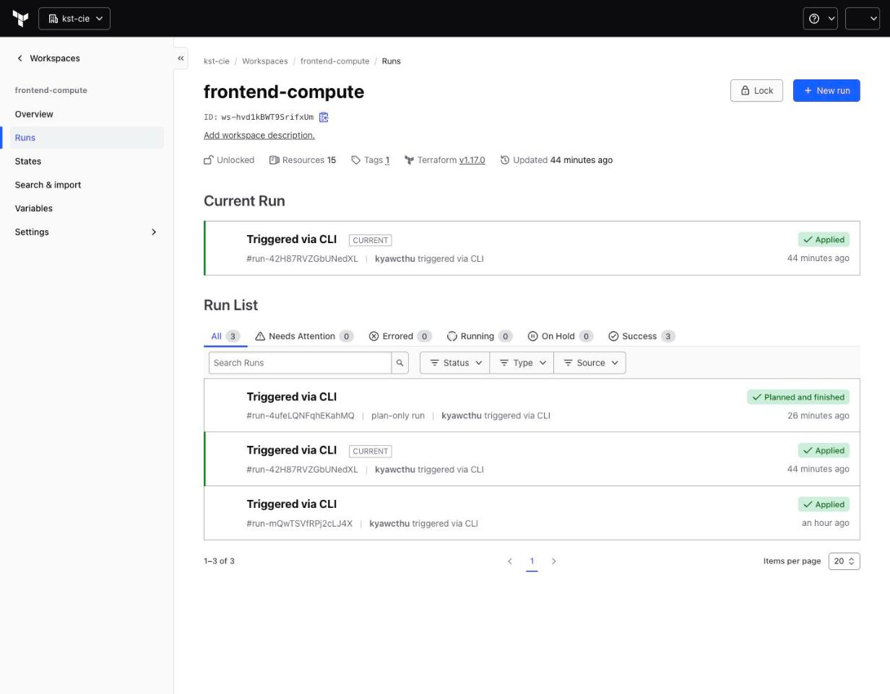
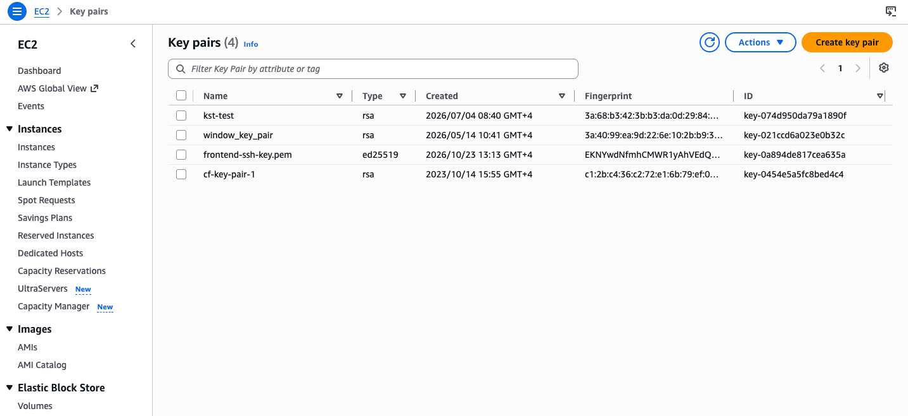
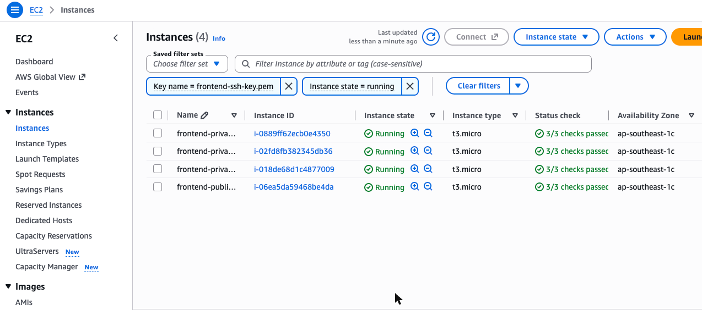
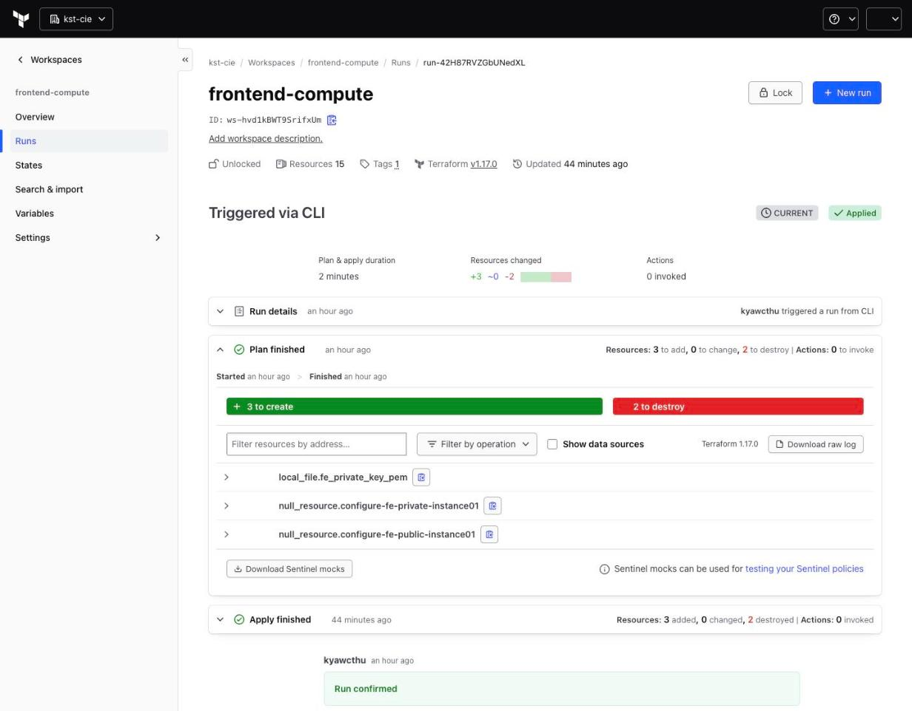
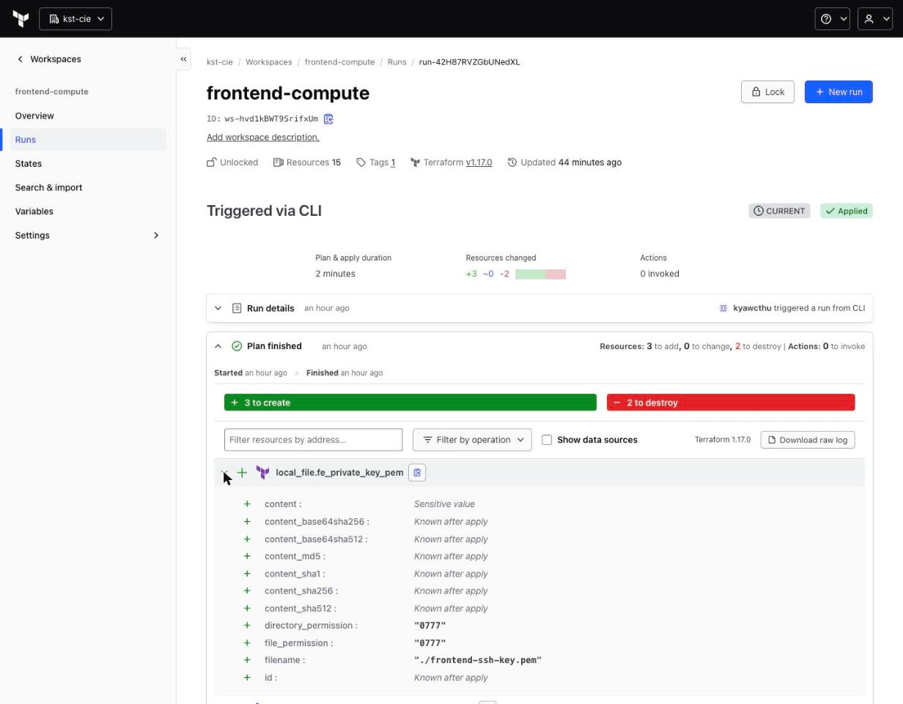
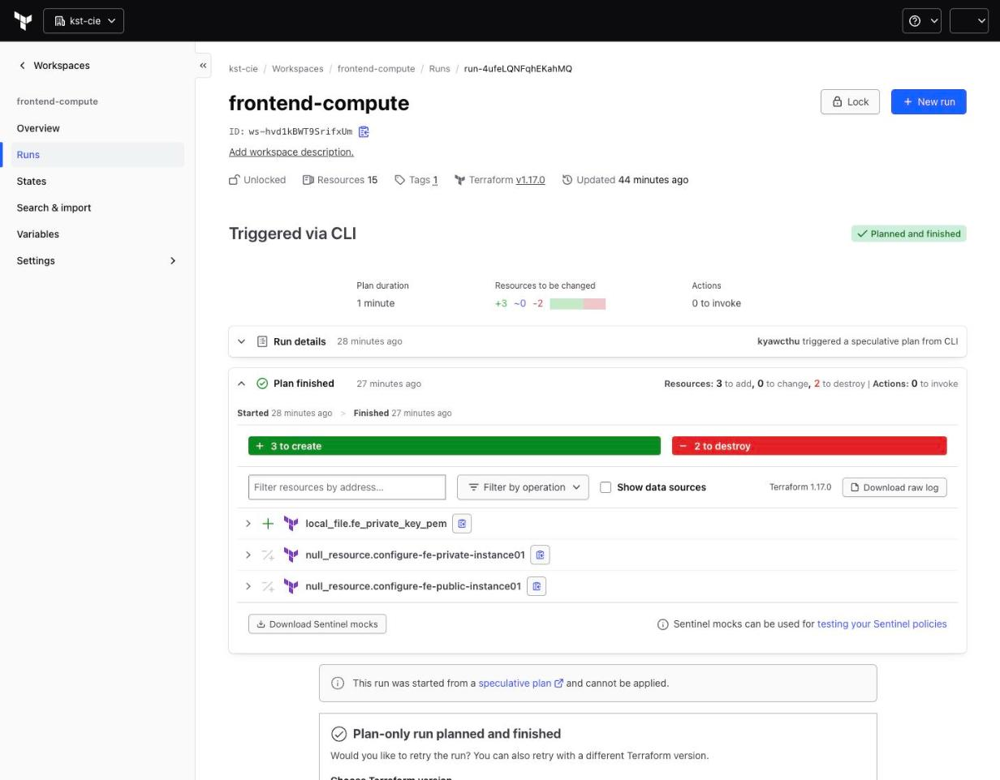

# Lesson 02: `local_file` + remote execution = a key nobody gets, and drift forever

> **Branch:** `02-local-file-drift` (builds on `01-hcp-migration-troubleshooting`, no code changes: we test the code as it is)
> **Drawing:** Excalidraw → Gitops → *tf-cloud 02 - local_file drift*
> **Tested:** 2026-10-23, `kst-cie/frontend-compute`, Terraform 1.17.0, AWS account `1733xxxx6280` / `ap-southeast-1`

## The code under test

[`frontend-compute/keypairs.tf`](../../frontend-compute/keypairs.tf), unchanged:

```hcl
locals {
  fe_private_key_filename = "${var.frontend_prefix}-ssh-key.pem"
}

resource "tls_private_key" "fe_keypair" {
  algorithm = "ED25519"
}

resource "aws_key_pair" "fe_keypair" {
  key_name   = local.fe_private_key_filename
  public_key = tls_private_key.fe_keypair.public_key_openssh
}

# Automatically save the private key locally for frontend instances
resource "local_file" "fe_private_key_pem" {
  content  = tls_private_key.fe_keypair.private_key_pem
  filename = "${path.module}/${local.fe_private_key_filename}"
  # file_permission      = "0400" # Secure file permissions required for SSH keys
  # directory_permission = "0700"
}
```

| Block | What it does | Where the result goes |
|---|---|---|
| `tls_private_key` | generates an Ed25519 key pair | **both halves are stored in Terraform state** |
| `aws_key_pair` | uploads the **public** half | EC2 → Key pairs (instances use it via `key_name`) |
| `local_file` | writes the **private** half to disk | the disk of **whichever machine runs `terraform`** |

**The question:** with HCP Terraform remote execution, which machine is that?

---

## 1. Why `local_file` "doesn't work" with remote execution

With **Remote** execution mode, every plan and apply runs on a **short-lived HCP Terraform agent** (a Linux VM), not on your laptop.

```
your laptop ──(uploads config)──▶ HCP agent (runs terraform) ──▶ AWS
                                       │
                                       └─ local_file writes HERE, then the VM is destroyed
```

| Behaviour | Result |
|---|---|
| `local_file` writes `frontend-ssh-key.pem` | It lands on the agent's disk and is **destroyed after the run**. You never see it. |
| Next run | The provider sees the file is missing → **plans to recreate it every run** (permanent drift) |
| `${path.module}/files/` used by the `file` provisioner | ✅ Works, because repo files are uploaded with the configuration |

### Ways to get a file back to your machine

| Option | How | When to use |
|---|---|---|
| **Sensitive output** | `output "x" { sensitive = true }` → `terraform output -raw x > file` | Labs, quick retrieval → **lesson 03** |
| **Secrets manager** | Terraform writes the value to AWS Secrets Manager / SSM Parameter Store / Vault; humans fetch it with IAM-controlled access | ✅ Enterprise → **lesson 04** |
| **Local execution mode** | Workspace → Settings → General → Execution Mode: **Local**. Runs on your laptop; state stays in HCP | Personal/dev only. You lose central runs, policy checks and shared credentials. |
| **Self-hosted HCP agent** | Runs execute on your own agent pool | For network reach into private environments. Still not "your laptop". |

## 2. Is `hashicorp/local` useless with remote execution?

**No, but its job changes.** Treat the agent's filesystem as **scratch space for the current run only.**

| Use case | Works remotely? |
|---|---|
| `data "local_file"` reading files committed in the repo | ✅ Yes (prefer `file()` / `templatefile()`) |
| Rendering a temp file consumed **in the same run** (e.g. by a provisioner) | ✅ Yes |
| Producing an artifact a human needs afterwards (keys, kubeconfig, inventory) | ❌ No. Use outputs or a secrets manager. |

---

## 3. Lab evidence (real runs)

Raw logs are in [`evidence/`](evidence/); screenshots are in [`screenshots/`](screenshots/).

### ① `terraform apply` on the Mac runs on an HCP agent

```
$ terraform version            # the Mac
Terraform v1.17.0
on darwin_arm64

$ terraform apply
Running apply in HCP Terraform. Output will stream here.
...
Terraform v1.17.0
on linux_amd64                 # ← the HCP agent VM runs the code
```



### ② Apply #1 (09:11 UTC): key, file and key pair created ([log](evidence/05-hcp-apply-1-apply-S8ErE7HgdYtWCCF5.log))

```
on linux_amd64
tls_private_key.fe_keypair: Creation complete after 0s [id=d0f90b97...]
local_file.fe_private_key_pem: Creation complete after 0s [id=b7c80b44...]
aws_key_pair.fe_keypair: Creation complete after 1s [id=frontend-ssh-key.pem]
Apply complete! Resources: 11 added, 0 changed, 0 destroyed.
```
`local_file` **did** run and **did** write the file, on the agent VM, which is thrown away when the run ends.

### ③ Back on the Mac: state says the file exists, the disk says no ([log](evidence/02-compute-state-vs-laptop.log))

```
$ terraform state show local_file.fe_private_key_pem
resource "local_file" "fe_private_key_pem" {
    directory_permission = "0777"
    file_permission      = "0777"      ← world-readable; ssh would refuse it anyway
    filename             = "./frontend-ssh-key.pem"
    id                   = "b7c80b44e528563c0c86e682f32e2d007390896c"
}

$ ls -la frontend-compute/*.pem
ls: *.pem: No such file or directory
```

### ④ AWS: key pair created once, used by 4 instances ([output](evidence/03-aws-keypair-before.txt))

```
$ aws ec2 describe-key-pairs --key-names frontend-ssh-key.pem
KeyPairId    key-0a894de817cea635a
Type         ed25519
Created      2026-10-23T09:13:06Z
Fingerprint  EKNYwdNfmhCMWR1yAhVEdQ2nvOcz3Om5jBHhfb2KF+U=   ← matches Terraform state
```




### ⑤ Apply #2 (09:19 UTC): `local_file` created again on a new agent ([log](evidence/05-hcp-apply-2-apply-Dw7wrVvhTxYLbo5M.log))

```
on linux_amd64                                  ← a NEW agent VM
local_file.fe_private_key_pem: Plan to create
local_file.fe_private_key_pem: Creation complete after 0s [id=b7c80b44...]   ← same hash as apply #1
Apply complete! Resources: 3 added, 0 changed, 2 destroyed.                   ← +2/-2 = null_resource timestamp()
```
`tls_private_key` and `aws_key_pair` are **not** in the plan, so AWS is untouched. The key pair is still the one created at 09:13:06.




### ⑥ Every new plan shows the same drift ([log](evidence/04-compute-plan-rerun.log), run `run-4ufeLQNFqhEKahMQ`)

```
local_file.fe_private_key_pem: Refreshing state... [id=b7c80b44...]
local_file.fe_private_key_pem: Drift detected (delete)

  # local_file.fe_private_key_pem will be created
Plan: 3 to add, 0 to change, 2 to destroy.
```



---

## 4. Why we shouldn't do this

| Finding | Impact |
|---|---|
| The `.pem` is written to a disposable HCP agent | Nobody can ever use the file. The purpose of `local_file` fails **silently**. |
| `Drift detected (delete)` → `will be created` on every run | Plans are never clean. Real drift hides among recurring noise, and teams learn to ignore plan output. |
| The private key still lives in state (`tls_private_key`) | Anyone with state read access has SSH access to all 4 instances. |
| `file_permission = "0777"` (default; the `0400` line is commented out) | Even when run locally, the key is world-readable and `ssh` rejects it. |

**Smaller issues in the same file:**
- For Ed25519, `private_key_openssh` is the safer format to hand to `ssh`. Terraform's own provisioner accepts both.
- `key_name = "frontend-ssh-key.pem"`: the `.pem` suffix is only cosmetic, but it appears in the EC2 console as the key pair's name.

**Is AWS affected?** No. The key pair and the 4 instances were created once (09:13 UTC) and never replaced by the drift.

---

## 5. What next: three fixes, one branch each

All three branch from **this** branch, so `git diff 02-local-file-drift <fix-branch>` shows only the fix.

| Branch | Fix | Private key in state? | SSH keys at all? | Use for |
|---|---|---|---|---|
| `03-option-b-sensitive-output` | `output … sensitive = true` + `terraform output -raw` | **yes** | yes | labs |
| `04-option-a-secrets-manager` | `ssh-keygen` → Secrets Manager → `ephemeral` read | **no** | yes | when SSH is unavoidable |
| `05-option-c-ssm-no-keys` | IAM role + SSM Session Manager, `user_data` | **no key exists** | **no** | ✅ production default |
