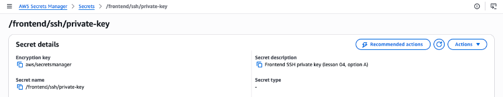
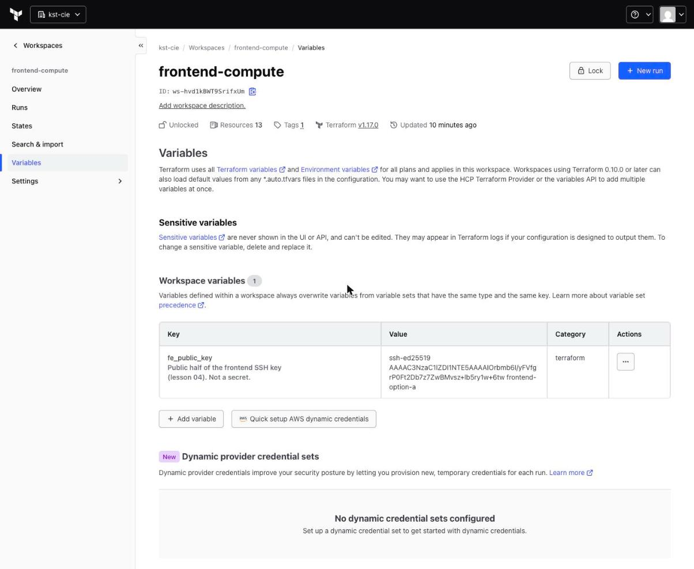
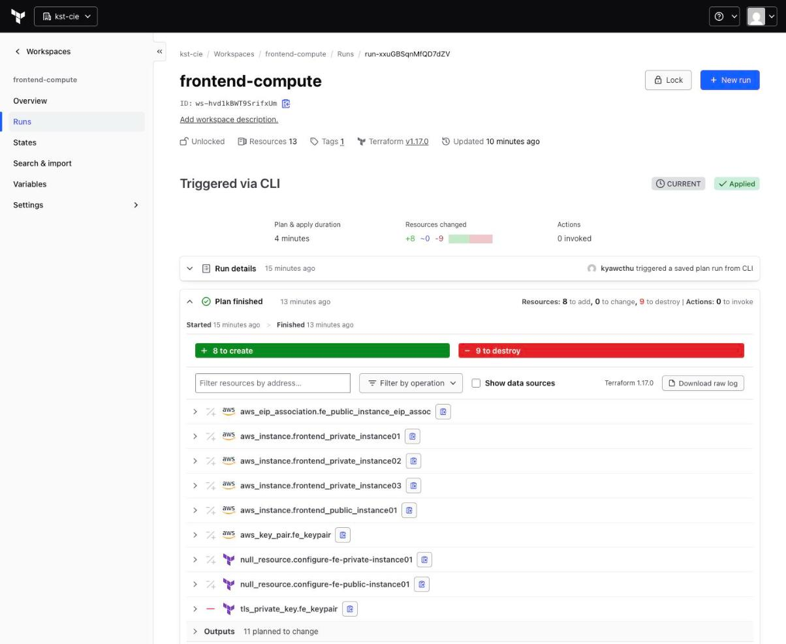
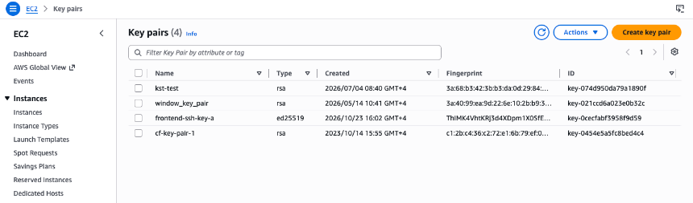

# Lesson 04: Option A, key in Secrets Manager, read with an ephemeral resource

> **Branch:** `04-option-a-secrets-manager` (builds on `02-local-file-drift`)
> **Drawing:** Excalidraw → Gitops → *tf-cloud 04 - option A secrets manager + ephemeral*
> **Tested:** 2026-10-23, `kst-cie/frontend-compute`, Terraform 1.17.0, AWS provider 6.69.1, AWS `1733xxxx6280` / `ap-southeast-1`
> **Compare:** `git diff 02-local-file-drift 04-option-a-secrets-manager -- frontend-compute/`

## Idea

Terraform should **use** the private key (for the provisioners' SSH connections) without **creating** it, **storing** it or **handing it out**.

- The key pair is created **outside Terraform**, once (`ssh-keygen`).
- **Public half** → a normal HCP workspace variable. It's not a secret.
- **Private half** → AWS Secrets Manager. Terraform reads it with an **`ephemeral`** resource (Terraform ≥ 1.10), which is never written to plan or state.

## Step 1: create the key outside Terraform ([log](evidence/01-keygen-and-secret.log), [log](evidence/02-hcp-variable-and-cleanup.log))

```bash
ssh-keygen -t ed25519 -N "" -C "frontend-option-a" -f frontend-key-a

aws secretsmanager create-secret --name /frontend/ssh/private-key \
  --description "Frontend SSH private key (lesson 04, option A)" \
  --secret-string file://frontend-key-a

# public half -> HCP workspace variable (category: terraform, sensitive: false)
cat frontend-key-a.pub      # ssh-ed25519 AAAAC3Nza...6tw frontend-option-a

rm -P frontend-key-a        # Secrets Manager is now the ONLY copy of the private key
```




## Step 2: the code

```hcl
# keypairs.tf
locals {
  fe_key_name = "${var.frontend_prefix}-ssh-key-a"
}

resource "aws_key_pair" "fe_keypair" {
  key_name   = local.fe_key_name
  public_key = var.fe_public_key                       # from the HCP variable
}

ephemeral "aws_secretsmanager_secret_version" "fe_private_key" {
  secret_id = var.fe_private_key_secret_id             # "/frontend/ssh/private-key"
}
```

```diff
# public-instances.tf / private-instances.tf: every connection block
-  private_key         = tls_private_key.fe_keypair.private_key_pem
+  private_key         = ephemeral.aws_secretsmanager_secret_version.fe_private_key.secret_string
-  bastion_private_key = tls_private_key.fe_keypair.private_key_pem
+  bastion_private_key = ephemeral.aws_secretsmanager_secret_version.fe_private_key.secret_string
```

`tls_private_key` and `local_file` are removed. New variables are `fe_public_key` (required) and `fe_private_key_secret_id` (default `/frontend/ssh/private-key`).

> The key pair is renamed to `frontend-ssh-key-a`, so `key_name` changes and the instances are rebuilt with the new public key. Keeping the old name would replace the key pair in AWS but leave the **old** key in each VM's `authorized_keys`.

## Step 3: saved plan, the key is read but not stored ([log](evidence/03-plan.log), run `run-xxuGBSqnMfQD7dZV`)

```
ephemeral.aws_secretsmanager_secret_version.fe_private_key: Opening...
ephemeral.aws_secretsmanager_secret_version.fe_private_key: Closing...
  # tls_private_key.fe_keypair will be destroyed        ← the generated key leaves state
  # aws_key_pair.fe_keypair must be replaced            ← new public key
  # aws_instance.* (4) must be replaced                 ← new key → new VMs
  # null_resource.configure-fe-* must be replaced
Plan: 8 to add, 0 to change, 9 to destroy.
```

## Step 4: apply, the provisioners SSH in with the ephemeral key ([log](evidence/04-apply.log))

```
ephemeral.aws_secretsmanager_secret_version.fe_private_key: Opening complete after 0s
tls_private_key.fe_keypair: Destruction complete after 0s
aws_key_pair.fe_keypair: Creation complete after 1s [id=frontend-ssh-key-a]
aws_instance.frontend_public_instance01: Creation complete after 15s [id=i-01a225715f721bdb9]
null_resource.configure-fe-public-instance01: (remote-exec): Connecting to remote host via SSH...
null_resource.configure-fe-public-instance01: Creation complete after 25s
null_resource.configure-fe-private-instance01: Creation complete after 50s      ← through the bastion
ephemeral.aws_secretsmanager_secret_version.fe_private_key: Closing complete after 0s
Apply complete! Resources: 8 added, 0 changed, 9 destroyed.
```



## Step 5: proof, the private key is not in state ([log](evidence/05-key-not-in-state.log), helper: [`keyinstate.py`](keyinstate.py))

```
$ terraform state pull | python3 keyinstate.py
(no output = no private key anywhere in state)

$ terraform state pull | grep -c "PRIVATE KEY"
0

$ terraform state list        → no tls_private_key, no ephemeral.* (ephemeral resources are never stored)
```
Compare with lesson 03: **4 plaintext copies** in state.

## Step 6: human access = IAM + audit ([log](evidence/06-human-access.log))

```
$ aws secretsmanager get-secret-value --secret-id /frontend/ssh/private-key \
    --query SecretString --output text > /tmp/fe-key && chmod 400 /tmp/fe-key
$ ssh -i /tmp/fe-key ec2-user@47.130.x.x "hostname; whoami"
ip-10-0-1-247.ap-southeast-1.compute.internal
ec2-user
$ chmod 600 /tmp/fe-key && rm -P /tmp/fe-key        # use it, then remove it
```
- **Who can read it:** whoever IAM allows `secretsmanager:GetSecretValue` on this secret.
- **Who did read it:** CloudTrail `GetSecretValue` events.



## Step 7: re-plan is clean ([log](evidence/07-replan.log), run `run-i8iYy8af4Pqd8eGK`)

```
ephemeral.aws_secretsmanager_secret_version.fe_private_key: Opening... Closing...   ← read again on every run
  # null_resource.configure-fe-private-instance01 must be replaced   (timestamp, known)
  # null_resource.configure-fe-public-instance01 must be replaced    (timestamp, known)
Plan: 2 to add, 0 to change, 2 to destroy.
```

---

## Verdict

| ✅ Pros | ❌ Cons |
|---|---|
| The private key is **never in Terraform plan or state** | Still a long-lived SSH key; port 22 still open |
| Access = IAM (who can read) + CloudTrail (who did read) | Provisioners still need SSH reach to the VMs (bastion) |
| Rotation: new `ssh-keygen` → `put-secret-value` + new `fe_public_key` → apply | A key handed to a human can still be copied |

**Use it when SSH is unavoidable** (legacy tooling, vendor appliances).

**Requirements:**
- Terraform ≥ 1.10 (ephemeral resources)
- an AWS provider with the `aws_secretsmanager_secret_version` ephemeral resource (we used 6.69.1)
- HCP's AWS credentials need `secretsmanager:GetSecretValue` on the secret

**Cost:** about $0.40/month per secret, plus API calls.

**Next:** `05-option-c-ssm-no-keys`, where there's **no SSH key at all**.
